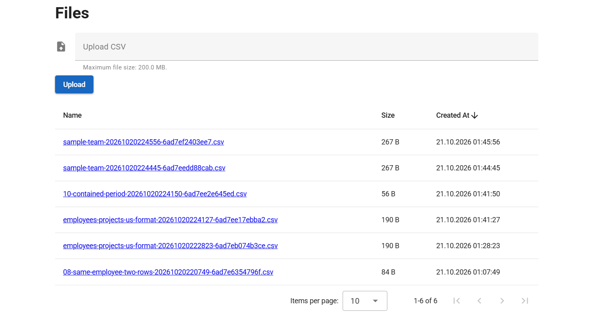
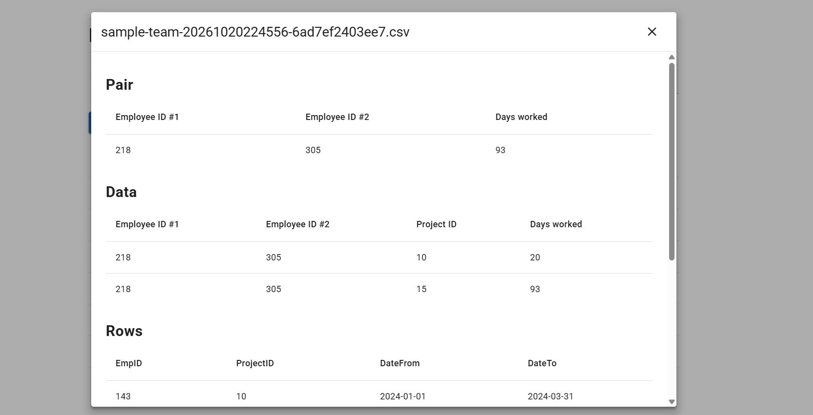
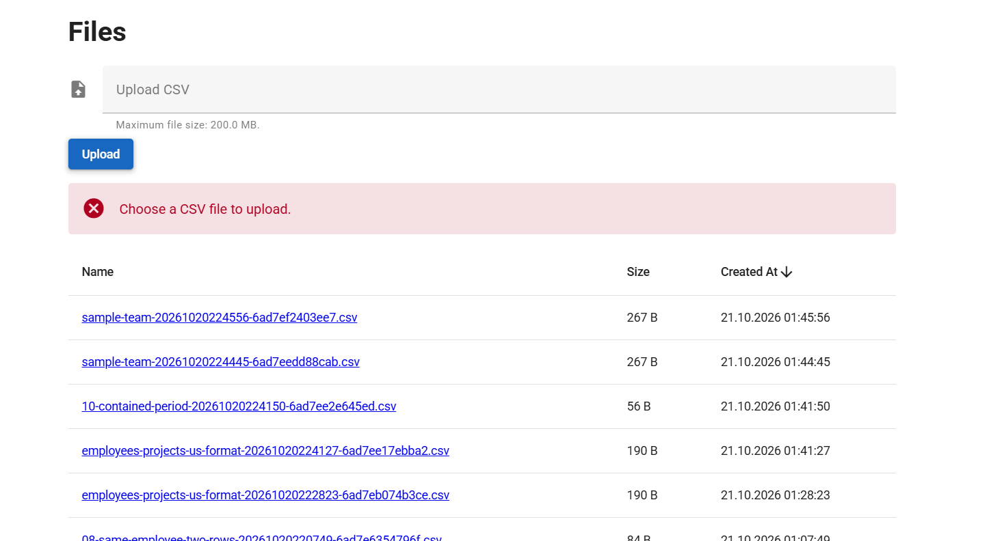

# Install

## Backend (Apache + PHP 8.4)

Needs PHP 8.4+, Composer, and Apache with `mod_rewrite`.

1. Install PHP 8.4+ and Composer.
2. Enable `mod_rewrite`.
3. From `be/`:

```bash
composer install
```

4. Serve `be/public` (the `.htaccess` there rewrites requests to `index.php`):

```apache
<VirtualHost *:80>
    ServerName stask.localhost
    DocumentRoot "/path/to/stask/be/public"

    <Directory "/path/to/stask/be/public">
        AllowOverride All
        Require all granted
    </Directory>
</VirtualHost>
```

5. Add `127.0.0.1 stask.localhost` to the hosts file and restart Apache.
6. Check `http://stask.localhost/files`.

`be/upload_files/` is created on the first upload.

From `be/`, run the tests (PHPUnit, `tests/`):

```bash
composer test
```

Validate the code with PHPStan (level 8, `src/`):

```bash
composer phpstan
```

`composer analyse` is the same as `composer phpstan`.

## Frontend (Node, Vue, Vuetify)

Vue 3, Vuetify, and Vite are already in the project. Needs Node.js 22+.

1. Install Node.js 22+.
2. From `fe/`, copy `.env.example` to `.env`. It should contain:

```
VITE_API_BASE_URL=http://stask.localhost
```

3. Install dependencies and start the dev server:

```bash
npm install
npm run dev
```

Open `http://localhost:3000`.

## Screenshots

The Files page lists uploaded CSV files and accepts a new one.



Opening a file shows the pair with the longest total time worked together across all shared projects, the days per project, and the CSV rows.



Uploading without a CSV shows an error.



## API

Base URL is `VITE_API_BASE_URL` (for example `http://stask.localhost`). Responses are JSON. Errors are `{ "error": "..." }`. CORS allows `GET`, `POST`, and `OPTIONS`.

CSV columns are `EmpID`, `ProjectID`, `DateFrom`, `DateTo`. An empty `DateTo` is treated as today.

- `GET /files` — uploaded CSV files: `[{ "name", "size", "createdAt" }]`.
- `POST /files` — upload with `multipart/form-data`, field `file` (`.csv` only). Success is `201` and the same object `{ "name", "size", "createdAt" }`. `400` if the file is invalid, `413` if it exceeds the PHP limit (`upload_max_filesize` / `post_max_size`).
- `GET /files/limit` — current upload limit: `{ "maxBytes" }`.
- `GET /files/{name}.csv` — file contents: `{ "name", "rows": [{ "EmpID", "ProjectID", "DateFrom", "DateTo" }] }`. `404` if the file is missing.
- `GET /files/{name}.csv/findLongestPeriodByProject` — the pair with the longest time worked together (days in `pair` are the sum across all shared projects; `data` is the per-project breakdown): `{ "pair": [{ "Employee ID #1", "Employee ID #2", "Days worked" }], "data": [{ "Employee ID #1", "Employee ID #2", "Project ID", "Days worked" }] }`. `404` if the file is missing.
